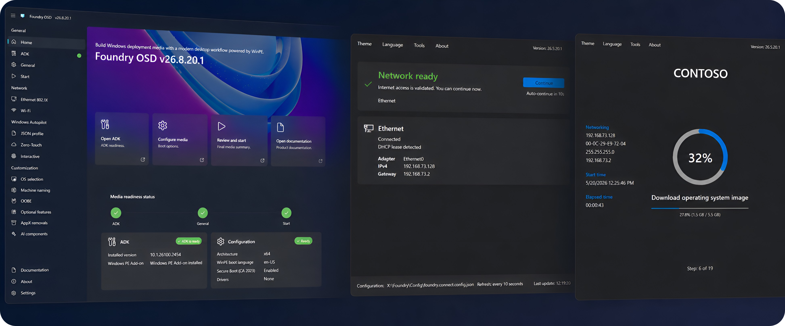

<h1>
  
</h1>

  
  
  
  
  

  
  
  

**From media creation to Windows installation**

Foundry is an open-source Windows 11 deployment solution for enterprise IT teams. Build bootable USB or ISO media on an administrator workstation, start the target device from it, and Foundry guides the technician through network setup and Windows installation.

  
  &nbsp;
  

Install x64 on most administrator workstations or ARM64 on Windows on Arm.

[Quick start](https://docs.foundryosd.com/start-here/quick-start) · [Documentation](https://docs.foundryosd.com) · [Release notes and asset digests](https://github.com/foundry-osd/foundry/releases/latest)

---

## How it works

Foundry uses three applications, one for each stage of the deployment:

1. **Foundry OSD** — configure the deployment and build bootable ISO or USB media from an administrator workstation.
2. **Foundry Connect** — start the target device in WinPE and validate Ethernet, Wi-Fi, or enterprise connectivity.
3. **Foundry Deploy** — choose the Windows content, target disk, drivers, firmware, and provisioning options, then run the deployment.

All three applications are available in 38 languages.

Operating system, driver pack, firmware, and WinPE metadata come from the maintained [`foundry-osd/catalog`](https://github.com/foundry-osd/catalog).

## What you can configure

- **Windows** — [release, edition, language, and licensing channel](https://docs.foundryosd.com/foundry-osd/customization/operating-system) from the catalog, or [your own ISO/WIM image](https://docs.foundryosd.com/foundry-osd/customization/custom-windows-images).
- **Setup experience** — [computer naming](https://docs.foundryosd.com/foundry-osd/customization/machine-naming), [OOBE, privacy, and local accounts](https://docs.foundryosd.com/foundry-osd/customization/oobe), [optional features](https://docs.foundryosd.com/foundry-osd/customization/optional-features), and removal of [AppX packages](https://docs.foundryosd.com/foundry-osd/customization/appx-removals) and [AI components](https://docs.foundryosd.com/foundry-osd/customization/ai-components).
- **Post-installation** — [scripts, commands, and EXE/MSI packages](https://docs.foundryosd.com/foundry-osd/customization/post-installation) run in order before OOBE.
- **Custom answer files** — [import your own Unattend file](https://docs.foundryosd.com/foundry-osd/customization/unattend) for anything beyond the built-in options.
- **Network** — [Ethernet, Wi-Fi, and enterprise 802.1X](https://docs.foundryosd.com/foundry-osd/network) in WinPE.
- **Provisioning** — [Windows Autopilot](https://docs.foundryosd.com/foundry-osd/autopilot) or [Active Directory domain join](https://docs.foundryosd.com/foundry-osd/domain-join).
- **Profiles and protection** — [save and share configurations](https://docs.foundryosd.com/foundry-osd/deployment-profiles) with your team, and optionally [require a technician password](https://docs.foundryosd.com/foundry-osd/general#password-protection) before deployment starts.

## Get started

1. Install the MSI matching the architecture of your administrator workstation.
2. Open Foundry OSD and use the **ADK** page to install the Windows ADK and Windows PE add-on if they are missing.
3. Configure the deployment, then create ISO or USB media.
4. Boot a representative test device and continue through Foundry Connect and Foundry Deploy.

[Follow the complete quick start →](https://docs.foundryosd.com/start-here/quick-start)

> [!NOTE]
> Foundry OSD runs on Windows 10 and Windows 11 with local administrator rights and internet access, and creates x64 or ARM64 deployment media. Target devices need internet access during deployment. Check [Requirements](https://docs.foundryosd.com/start-here/requirements) and [Supported versions](https://docs.foundryosd.com/reference/supported-versions) before deployment.

> [!IMPORTANT]
> Creating USB media erases the selected USB device. Deploying Windows can erase or repartition the selected target disk. Validate your configuration and test it on representative hardware before production use.

## Learn more

- [Configure networking](https://docs.foundryosd.com/foundry-osd/network)
- [Customize Windows](https://docs.foundryosd.com/foundry-osd/customization)
- [Prepare Windows Autopilot](https://docs.foundryosd.com/foundry-osd/autopilot)
- [Protect credentials and deployment media](https://docs.foundryosd.com/reference/security-and-credentials)
- [Troubleshoot a deployment](https://docs.foundryosd.com/troubleshooting)

## Contributing and support

Found a bug or have a feature request? Use the [issue chooser](https://github.com/foundry-osd/foundry/issues/new/choose). For setup questions and troubleshooting, follow the [support guide](SUPPORT.md).

Code contributions are welcome. Foundry is built with .NET 10, WinUI 3, and WPF; the [contributing guide](CONTRIBUTING.md) covers the development environment, solution map, and validation steps. Read it before starting substantial work, and report vulnerabilities privately through the [security policy](SECURITY.md).

## Telemetry and privacy

Anonymous usage telemetry and remote error diagnostics are enabled by default. Each can be disabled independently in Settings. See [Telemetry and privacy](https://docs.foundryosd.com/reference/telemetry-and-privacy) for details, and the [usage dashboard](https://eu.posthog.com/embedded/g_cVY9GEAqJEUIu-KgiXReDV-iixCQ) for the aggregated data.

## Supported by

  
   
  Foundry documentation is hosted with support from <strong>GitBook</strong>.

---

Foundry is available under the [MIT License](LICENSE). See [Third-Party Notices](THIRD_PARTY_NOTICES.md) and the [Code of Conduct](CODE_OF_CONDUCT.md).
